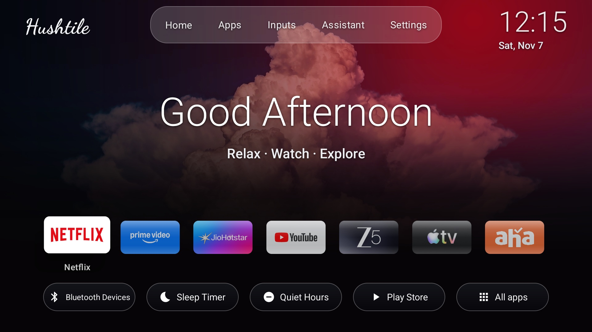
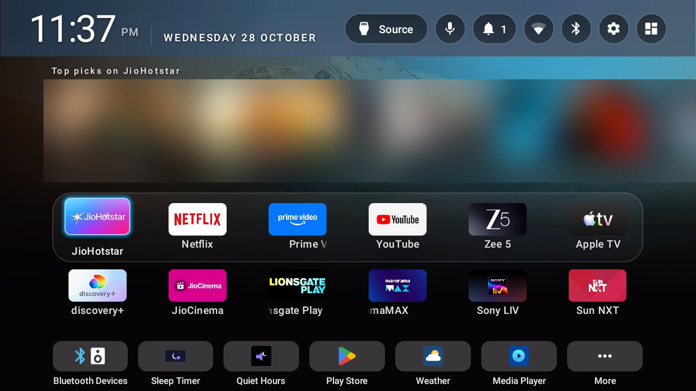

# Hushtile

**A free, ad-free home screen for Android TV and Google TV, with settings for 450+ tested TV models.**

[](LICENSE)
[](https://github.com/konoft/Hushtile/actions/workflows/sync-upstream.yml)

An ad-free home screen for Android TV, with a calm four-pane layout or a Cinematic one. Hushtile is built on
[cleanyourtv](https://github.com/Gathin23/cleanyourtv) (MIT) and carries what its community found on more than 400
tested TVs, so it knows how to open Live TV, the Source panel and the remote's keys on TVs we have never held. Those
TVs were tested by cleanyourtv's contributors, not by us; every Monday this repository brings in the ones they added
that week (`tools/sync_upstream.py`, run by `.github/workflows/sync-upstream.yml`).





> Hushtile is an independent project. It is not affiliated with Google, or with any TV or streaming brand named here;
> those names identify the TVs and apps it works with.

## What it does

1. **Top bar:** clock and date; Source; a mic that listens on TVs with their own microphone and opens search with the
   keyboard elsewhere; a notifications bell with a count; Wi-Fi with signal bars (crossed out offline); Bluetooth (on,
   off or a device connected); a settings menu with Picture, Sound, Network, Remotes and Apps.
2. **Suggestions:** a looping row of what your apps recommend, read from what each app publishes to the TV.
3. **Apps:** your 12 most-used apps in two rows, ordered by use; the rest in All apps.
4. **Tools:** Bluetooth devices, sleep timer, quiet hours, Play Store, weather and sources, with More for the rest.

**Two layouts**, chosen in Launcher settings > Layout: **Panes**, the four panes above, or **Cinematic** (designed by
KONOFT): your name at the top left, Home, Apps, Inputs, Assistant and Settings in a glass bar, a greeting where the
suggestions go until an app has some, one row of glass app tiles, and the tools as glass pills.

Also: App lock and a kids PIN, wallpapers with dimming (and, if you ask, pictures of the day from Wikimedia Commons,
each credited to its photographer), a clock screensaver, Home after the TV wakes, crisp text at
720p and 1080p, and a one-time **Finish setting up Hushtile** list that asks for each permission on the TV itself.

## How it fits a TV nobody here has tried

Three layers, each over the one before:

| Layer | Where | What it decides |
|---|---|---|
| Hushtile's look | `launcher/app/src/main/assets/hushtile.json` | Panes, tools, glass, glow, wallpaper rotation |
| The tested TV | `launcher/app/src/main/assets/profiles.json`, built from `examples/` | Live TV app, Source panel, remote keys, apps to hide |
| Your theme | pushed over ADB (`tools/theme.sh`, `devices/*/push-theme.sh`) | Anything you want different |

At start Hushtile compares the TV's brand and codenames (device, board, model) with the tested TVs in `examples/` and
takes that TV's settings. A TV with no match still gets the Live TV app or Source panel that every tested TV with the
same maker's app used. Regenerate the profiles after changing `examples/`:

```sh
python3 launcher/profiles/gen_profiles.py
```

## Install

Hushtile needs Android 8 (API 26) or newer. Releases carry the built app; or build it yourself with JDK 17 and the
Android SDK (platform 34, build-tools 34.0.0):

```sh
cd launcher && ./gradlew assembleRelease
adb connect <tv ip>:5555
adb install -r app/build/outputs/apk/release/app-release.apk
```

The app installs as `com.hushtile.home`. Its Java package and the add-on card names stay `com.gathin.tvhome`, so
cleanyourtv's add-ons work with it unchanged.

Then choose Hushtile as Home. Most Android TV sets let you; newer Google TV devices keep their own home screen, and
there Hushtile opens like an app. To remove the TV's ads as well, follow `PROMPT.md` with the list for your TV in
`examples/`; everything is disabled, never uninstalled, and `tools/restore.sh` puts it back.

## Repository

| Path | What |
|---|---|
| `launcher/` | The Hushtile app, with `profiles/gen_profiles.py` |
| `examples/` | Tested TVs from cleanyourtv, plus the Nokia ATV R1: ad lists (`debloat.txt`), `tv.json`, settings |
| `devices/` | The two TVs Hushtile was built on, with their themes and undo scripts |
| `addons/` | Tool apps (weather, sleep timer, Bluetooth and more), by their authors |
| `themes/` | Looks and wallpapers, each with its credits |
| `tools/`, `tests/`, `docs/` | The ADB tools, their tests and the guides, from cleanyourtv |

## Privacy

Hushtile has no accounts, ads, analytics or tracking. It goes online for one thing: when you choose **Get new
wallpapers from Wikimedia Commons** in Launcher settings, it downloads the last eight pictures of the day from
Wikimedia. What it shows on Home is read from the apps already on your TV.

## Credits and licence

MIT, as `LICENSE` says: the cleanyourtv code and lists are © Gathin and its contributors, Hushtile's changes ©
KONOFT. The **Cinematic layout** (Launcher settings > Layout) was designed by KONOFT. Add-ons keep their authors' names. Wallpapers are generated by code, credited in each theme's
`CREDITS.md` (CC BY / CC BY-SA, so those credits must stay with them), or credited on the TV when downloaded from
Wikimedia Commons. App and TV names belong to their owners.

---

If Hushtile made your TV calmer, a ⭐ on this repository helps other people find it.
